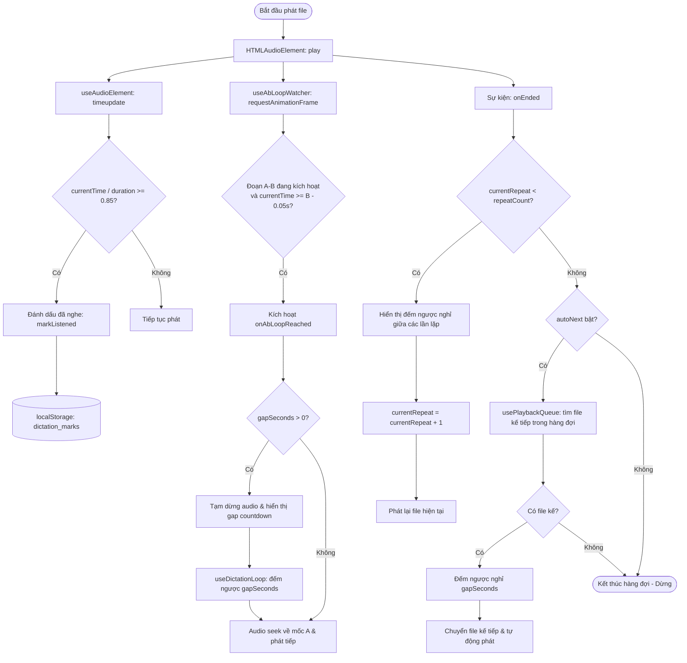

# KIẾN TRÚC HỆ THỐNG (ARCHITECTURE GUIDE)

> **Dự án:** Nghe chép — Audio Dictation Player (`listening-dictation-app`)  
> **Cấu trúc phân tầng:** Unidirectional Layered Architecture  
> **Môi trường:** Client-Side PWA / Next.js 16 Static Export

---

## 1. Sơ Đồ Cây Thư Mục & Phân Tầng Mã Nguồn

Hệ thống được tổ chức thành 5 tầng phụ thuộc nghiêm ngặt theo hướng một chiều:

```
[Layer 5: App Shell & Orchestrator]
   app/page.tsx, components/dictation-app.tsx, components/dictation-layout.tsx
                           │
                           ▼
[Layer 4: Feature Workspaces & Sections]
   components/app-main-workspace.tsx, components/sidebar.tsx,
   components/player-card.tsx, components/toolbar-card.tsx,
   components/welcome/*, components/pwa/*
                           │
                           ▼
[Layer 3: Reusable UI Primitives]
   components/ui/modal.tsx, components/ui/segmented-control.tsx,
   components/ui/slider-field.tsx, components/ui/number-field.tsx,
   components/ui/switch.tsx, components/ui/language-toggle.tsx
                           │
                           ▼
[Layer 2: Application State & Control Hooks]
   hooks/use-audio-player.ts, hooks/use-audio-element.ts, hooks/use-waveform.ts,
   hooks/use-playback-queue.ts, hooks/use-repeat-controller.ts,
   hooks/use-ab-loop.ts, hooks/use-ab-loop-watcher.ts, hooks/use-folder-library.ts
                           │
                           ▼
[Layer 1: Pure Domain Libraries & Infrastructure]
   lib/queue.ts, lib/abLoop.ts, lib/naturalSort.ts, lib/format.ts,
   lib/fs.ts, lib/idb.ts, lib/storage.ts, lib/keyboard.ts, lib/constants.ts
```

### Danh mục file chi tiết:
```text
listening-dictation-app/
├── app/
│   ├── layout.tsx              # Root HTML, SEO Metadata, Schema.org WebApplication JSON-LD, Viewport
│   ├── page.tsx                # Client Entry point với dynamic import (ssr: false)
│   ├── globals.css             # Tailwind v4 import, CSS variables (:root & dark mode), animations
│   └── icon.svg                # Favicon gốc SVG
├── components/
│   ├── ab-loop-controls.tsx     # Bộ nút điều khiển A-B (Đặt A, Đặt B, Xóa)
│   ├── app-main-workspace.tsx  # Workspace nghe: PermissionBanner + TrackHeader + PlayerCard + Toolbar + ShortcutsFooter
│   ├── dictation-app.tsx       # Root Orchestrator: phối hợp toàn bộ hooks, điều kiện hasFolder
│   ├── dictation-layout.tsx    # Layout Container: Sidebar + AppMainWorkspace + Dialogs + Toast
│   ├── dictation-welcome-view.tsx # Shell bọc WelcomeScreen khi chưa chọn thư mục
│   ├── permission-banner.tsx   # Banner yêu cầu cấp lại quyền đọc folder (Chrome/Edge sau khi F5)
│   ├── player-card.tsx         # Thẻ phát audio: Waveform, A-B Region, Progress, Transport Controls, Badges
│   ├── player-controls.tsx     # Nhóm nút: Prev, -5s Rewind, Play/Pause, +5s Forward, Next, Replay
│   ├── pwa/
│   │   ├── install-button.tsx  # Nút cài PWA (prompt native trên Chromium, modal hướng dẫn trên Safari)
│   │   ├── offline-badge.tsx   # Badge thông báo mất mạng
│   │   └── update-toast.tsx    # Toast thông báo khi Service Worker có bản cập nhật mới
│   ├── queue-chip.tsx          # Chip hiển thị trạng thái hàng đợi (bộ lọc đang chọn và số câu)
│   ├── reset-dialog.tsx        # Modal xác nhận xóa sạch dữ liệu và cài đặt
│   ├── shortcuts-dialog.tsx    # Modal danh mục phím tắt bàn phím
│   ├── shortcuts-footer.tsx    # Thanh gợi ý phím tắt chân trang (phím sáng khi bấm)
│   ├── sidebar.tsx             # Sidebar danh sách file, tìm kiếm, bộ lọc (Tất cả, Chưa nghe, Đã nghe, Gắn sao)
│   ├── sidebar-collapsed.tsx   # Dạng thu gọn của sidebar (icon-only mode)
│   ├── sidebar-file-item.tsx   # Hàng tệp (FileRow): hiển thị STT tự nhiên, tên cắt ngắn, sao, đã nghe
│   ├── sidebar-folder-card.tsx # Thẻ tiêu đề thư mục và nút đổi thư mục
│   ├── toolbar-card.tsx        # Cấu hình: Tốc độ (5 pill), Âm lượng, Bước tua, Lặp câu, Thời gian nghỉ, AutoNext
│   ├── track-header.tsx        # Tiêu đề file đang phát, số thứ tự trong hàng đợi, nút gắn sao, nút phím tắt
│   ├── ui/
│   │   ├── app-brand.tsx       # Logo và tên thương hiệu ứng dụng
│   │   ├── language-toggle.tsx # Nút chuyển ngữ VI / EN
│   │   ├── modal.tsx           # Hộp thoại modal cơ sở (Accessible, focus capture, Escape key)
│   │   ├── number-field.tsx    # Ô nhập số tự do kèm đơn vị (lần, giây)
│   │   ├── segmented-control.tsx # Điều khiển dạng phân đoạn trượt
│   │   ├── skip-icon.tsx       # SVG icon tua kèm số giây tương ứng
│   │   ├── slider-field.tsx    # Thanh trượt tùy biến (Volume, Bước tua)
│   │   └── switch.tsx          # Công tắc Toggle on/off
│   ├── waveform-handle.tsx     # Tay cầm kéo rê mốc A và B trên sóng âm
│   ├── waveform-region.tsx     # Vùng chọn lặp A-B trên sóng âm
│   ├── waveform-region-overlay.tsx # Khối màu mờ highlight đoạn A-B
│   └── welcome/
│       ├── preview-bars.ts     # Dữ liệu 56 thanh sóng âm mô phỏng
│       ├── welcome-background.tsx # 5 quầng sáng radial động và sao lấp lánh
│       ├── welcome-features.tsx # 3 thẻ giới thiệu tính năng nổi bật
│       ├── welcome-floating-chips.tsx # 4 chip tính năng nổi bay lơ lửng quanh preview player
│       ├── welcome-hero.tsx    # Tiêu đề lớn, slogan gradient, CTA chính & phụ
│       ├── welcome-preview-controls.tsx # Nút điều khiển trang trí của preview player
│       ├── welcome-preview-player.tsx # Thẻ Glassmorphism hiển thị player mô phỏng sóng âm thở
│       ├── welcome-recent-folders.tsx # Danh sách thư mục đã mở gần đây (tối đa 3 thư mục)
│       ├── welcome-safari-banner.tsx # Ghi chú hạn chế bộ nhớ folder trên WebKit/Safari
│       └── welcome-screen.tsx  # Component chính của trang chào
├── docs/
│   ├── AI_DEVELOPMENT_WORKFLOW.md # Quy trình 6 bước phát triển feature chuẩn hóa cho AI Agent
│   ├── ARCHITECTURE.md          # Kiến trúc phân tầng (5 layers), module catalog, data flow, state
│   ├── AUDIT_REPORT.md          # Báo cáo audit tài liệu, bảng sai lệch, rủi ro kỹ thuật & khuyến nghị
│   ├── BASELINE.md              # Số liệu kỹ thuật lịch sử tại mốc bắt đầu Phase 3
│   ├── BEHAVIOR_CATALOG.md      # Danh mục hành vi thực tế (Ground Truth), business rules, phím tắt
│   ├── DEPLOY.md                # Hướng dẫn deploy Vercel static export, PWA headers & SW update
│   ├── INDEX.md                 # Bản đồ điều hướng trung tâm (PKB Single Entry Point) & 8 invariants
│   ├── REFACTOR_PLAN.md         # Kế hoạch tái cấu trúc lịch sử của Phase 3
│   ├── STORAGE.md               # Kiến trúc lưu trữ: IndexedDB, LocalStorage, File System Access API
│   ├── TESTING.md               # Hướng dẫn kiểm thử, kiến trúc mock, phân tích coverage thực tế
│   └── UI_UX_CATALOG.md         # Inventory màn hình, design tokens, UI primitives catalog
├── hooks/
│   ├── use-ab-loop.ts          # State mốc A-B thuần túy (a: number | null, b: number | null)
│   ├── use-ab-loop-watcher.ts  # requestAnimationFrame loop kiểm tra chạm mốc B để tua về A
│   ├── use-audio-element.ts    # Quản lý vòng đời HTMLAudioElement, preservesPitch, thu hồi Object URL
│   ├── use-audio-player.ts     # Audio engine orchestrator hook (phối hợp MediaElement + WaveSurfer)
│   ├── use-dark-mode.ts        # Theo dõi prefers-color-scheme của hệ thống
│   ├── use-dictation-actions.ts # Đóng gói toàn bộ action callbacks cho components
│   ├── use-dictation-loop.ts   # Bộ đếm thời gian nghỉ (gap countdown interval)
│   ├── use-folder-library.ts   # State thư viện audio, đồng bộ dấu sao và đã nghe từ localStorage
│   ├── use-folder-loader.ts    # Giao tiếp File System Access API & fallback Safari input
│   ├── use-keyboard-shortcuts.ts # Lắng nghe phím tắt toàn cục và kiểm tra focus an toàn
│   ├── use-online-status.ts    # Theo dõi trạng thái mạng online / offline
│   ├── use-playback-queue.ts   # Xây dựng hàng đợi theo bộ lọc/tìm kiếm, điều hướng next/prev
│   ├── use-player-settings.ts  # Quản lý và lưu trữ cài đặt người nghe vào localStorage
│   ├── use-pwa-install.ts      # Bắt sự kiện beforeinstallprompt
│   ├── use-repeat-controller.ts # Điều phối chu kỳ lặp câu, đếm ngược nghỉ chép bài, tự chuyển câu
│   ├── use-service-worker.ts   # Quản lý đăng ký SW và vòng đời cập nhật (SKIP_WAITING)
│   ├── use-sidebar-state.ts    # Quản lý trạng thái mở/đóng sidebar
│   └── use-waveform.ts         # Quản lý WaveSurfer.js canvas, peaks, theme sync, resize observer
├── lib/
│   ├── abLoop.ts               # Logic thuần tính toán mốc A-B, clamp, swap, validate
│   ├── audio.ts                # Cấu hình cao độ và tốc độ phát chuẩn cho MediaElement
│   ├── constants.ts            # Tập trung hằng số hệ thống (ngưỡng 20MB, 0.3s, 85%, storage keys)
│   ├── db.ts                   # Bridge tương thích ngược đến lib/idb.ts (legacy, unused)
│   ├── file-system.ts          # Bridge tương thích ngược định nghĩa AudioFile và re-export fs helpers
│   ├── format.ts               # Định dạng thời gian (mm:ss), tên file
│   ├── fs.ts                   # Quét thư mục, phân loại đuôi file audio hợp lệ
│   ├── i18n.tsx                # Context đa ngôn ngữ nhẹ Việt / Anh
│   ├── idb.ts                  # Giao tiếp IndexedDB lưu trữ FileSystemDirectoryHandle
│   ├── keyboard.ts             # Phân loại và khớp phím tắt bàn phím
│   ├── naturalSort.ts          # Thuật toán sắp xếp chuỗi tự nhiên hỗ trợ số và tiếng Việt
│   ├── pwa.ts                  # Helper đăng ký Service Worker và nhận diện Standalone mode
│   ├── queue.ts                # Logic thuần xây dựng hàng đợi, tìm kiếm, next/prev
│   └── storage.ts              # Đọc/ghi localStorage (Settings, Session, Marks, RecentFolders)
├── messages/
│   ├── en.json                 # Từ điển tiếng Anh
│   └── vi.json                 # Từ điển tiếng Việt
├── public/
│   ├── apple-touch-icon.png    # Icon iOS (180x180)
│   ├── favicon.ico             # Favicon legacy
│   ├── favicon.svg             # Favicon SVG
│   ├── icons/                  # Bộ icon PWA (192, 512, maskable 512)
│   ├── manifest.webmanifest    # Web App Manifest PWA
│   └── sw.js                   # Service Worker tĩnh
├── tests/
│   ├── components/ui.test.tsx  # Component test UI primitives
│   ├── fixtures/legacy-storage.json # Dữ liệu mock migration
│   ├── hooks/                  # Hook tests (6 suites)
│   ├── setup/                  # Browser & FS mocks
│   └── unit/                   # Unit tests logic thuần (10 suites)
├── AGENTS.md                   # Hướng dẫn AI Coding Agent & PKB entry point
├── eslint.config.mjs           # Cấu hình ESLint 9
├── LICENSE                     # Giấy phép MIT
├── next.config.ts              # Cấu hình Next.js (output: 'export')
├── package.json                # Dependencies và scripts
├── postcss.config.mjs          # Cấu hình PostCSS
├── README.md                   # Giới thiệu dự án (English)
├── README.vi.md                # Giới thiệu dự án (Tiếng Việt)
├── tsconfig.json               # Cấu hình TypeScript 5
├── vercel.json                 # Cấu hình deploy Vercel
└── vitest.config.ts            # Cấu hình kiểm thử Vitest
```

---

## 2. Quy Tắc Phụ Thuộc (Dependency Rules) & Ranh Giới Module

1. **Layer 1 (`lib/`) phải là Pure Modules (Trừ `i18n.tsx`):**
   - Không được import React, ReactDOM, Hooks hoặc UI components.
   - Các hàm trong `lib/abLoop.ts`, `lib/queue.ts`, `lib/naturalSort.ts`, `lib/format.ts` phải là pure functions: cùng input luôn cho cùng output, không side-effect.
2. **Layer 2 (`hooks/`) quản lý State & Side Effects:**
   - Mỗi hook đảm nhiệm đúng một phạm vi chức năng (Single Responsibility).
   - Hook có thể gọi các pure functions từ `lib/`.
   - Hook KHÔNG render JSX.
3. **Layer 3 (`components/ui/`) là Reusable Primitives:**
   - Chỉ phụ thuộc vào props, `lib/i18n.tsx`, và CSS classes.
   - Không được import các feature hooks chuyên biệt (như `useAudioPlayer`, `useFolderLibrary`).
4. **Layer 4 (`components/*`) là Feature Components:**
   - Nhận state và callbacks từ Layer 5 hoặc custom hooks.
5. **Layer 5 (`components/dictation-app.tsx`) là Orchestrator:**
   - Nơi duy nhất kết nối tất cả các hooks lại với nhau và truyền dữ liệu xuống cây component.
   - Không chứa business logic tính toán trực tiếp.

---

## 3. Kiến Trúc Luồng Dữ Liệu (Data Flow)

### 3.1. Luồng Nạp Thư Mục & Khôi Phục Phiên

```mermaid
sequenceDiagram
    autonumber
    actor User as Người dùng
    participant Loader as useFolderLoader
    participant IDB as IndexedDB (dictation_db)
    participant LibFS as lib/fs.ts
    participant Library as useFolderLibrary
    participant Storage as localStorage (dictation_*)
    participant Queue as usePlaybackQueue
    participant Player as useAudioPlayer

    User->>Loader: Click "Chọn thư mục audio"
    alt Chrome / Edge (showDirectoryPicker)
        Loader->>User: Mở hộp thoại chọn thư mục gốc của OS
        User-->>Loader: Cấp quyền truy cập FileSystemDirectoryHandle
        Loader->>IDB: Lưu handle vào store "handles" (key: "folderHandle")
        Loader->>LibFS: Quét đệ quy file audio hợp lệ (.mp3, .m4a, .wav...)
    else Safari / Mobile (<input webkitdirectory>)
        Loader->>User: Mở bộ chọn file Safari
        User-->>Loader: Chọn file từ input
        Loader->>LibFS: Đọc FileList từ input.files
    end
    LibFS-->>Loader: Trả về { folderName, files[] }
    Loader->>Library: onFilesLoaded(folderName, files)
    Library->>Storage: Đọc dictation_marks (dấu sao & đã nghe)
    Library->>Storage: Đọc dictation_session (câu đang nghe dở lần trước)
    Library->>Library: Ghép marks vào danh sách file
    Library->>Storage: Cập nhật dictation_recent_folders
    Library->>Queue: Cung cấp filteredFiles & active track
    Queue->>Player: Nạp file đầu tiên / file khôi phục vào audio element
```



---

### 3.2. Luồng Phát Âm Thanh, Đếm Ngược Nghỉ & Lặp Câu



---

## 4. Ma Trận Sở Hữu Trạng Thái (State Ownership Matrix)

| Tên State | Thuộc Hook / Module | Loại State | Nơi Lưu Trữ (Persistence) | Mục Đích & Ảnh Hưởng |
|---|---|---|---|---|
| `language` | `usePlayerSettings` | React State | `localStorage (dictation_settings)` | Ngôn ngữ giao diện (`vi` / `en`), đổi tức thì không reload |
| `playbackRate` | `usePlayerSettings` | React State | `localStorage (dictation_settings)` | Tốc độ phát (`0.5x`, `0.75x`, `1x`, `1.25x`, `1.5x`), giữ cao độ |
| `volume` | `usePlayerSettings` | React State | `localStorage (dictation_settings)` | Mức âm lượng (0 – 1) |
| `skipSeconds` | `usePlayerSettings` | React State | `localStorage (dictation_settings)` | Bước nhảy khi bấm tua `←` / `→` (1s – 30s) |
| `autoNext` | `usePlayerSettings` | React State | `localStorage (dictation_settings)` | Tự động chuyển bài khi hết số lần lặp (boolean) |
| `repeatCount` | `usePlayerSettings` | React State | `localStorage (dictation_settings)` | Số lần lặp lại mỗi bài (1 – 99) |
| `gapSeconds` | `usePlayerSettings` | React State | `localStorage (dictation_settings)` | Khoảng thời gian nghỉ chép bài giữa các lần lặp (0s – 30s) |
| `sidebarCollapsed` | `useSidebarState` | React State | `localStorage (dictation_settings)` | Trạng thái thu gọn/mở rộng sidebar trên desktop/tablet |
| `folderHandle` | `useFolderLoader` | Handle Ref | `IndexedDB (dictation_db)` | FileSystemDirectoryHandle để mở lại thư mục mà không cần chọn lại (Chromium) |
| `lastFile` | `useFolderLibrary` | Memory / Ref | `localStorage (dictation_session)` | Tên file đang nghe dở trong thư mục hiện tại |
| `marks` | `useFolderLibrary` | Memory State | `localStorage (dictation_marks)` | Bản đồ đánh dấu `{ [folder]: { [file]: { listened, star } } }` |
| `recentFolders` | `useFolderLibrary` | Subscribed State | `localStorage (dictation_recent_folders)` | Danh sách tối đa 3 thư mục đã mở gần đây kèm tiến độ |
| `currentFileId` | `useFolderLibrary` | React State | Runtime (đồng bộ qua session) | ID định danh duy nhất của audio file đang nạp |
| `filter` | `useFolderLibrary` | React State | Runtime (Reset về "all" khi chọn thư mục mới) | Bộ lọc hàng đợi: `"all"` \| `"unheard"` \| `"listened"` \| `"starred"` |
| `searchQuery` | `useFolderLibrary` | React State | Runtime | Từ khóa tìm kiếm file theo tên hoặc số index |
| `abLoop` | `useAbLoop` | React State | Runtime (KHÔNG lưu localStorage) | Mốc `{ a: number \| null, b: number \| null }` |
| `isPlaying` | `useAudioElement` | React State | Runtime | Trạng thái đang phát hay tạm dừng của thẻ `<audio>` |
| `currentRepeat` | `useDictationLoop` | React State | Runtime | Lượt lặp hiện tại của bài (1 ... repeatCount) |
| `isWaitingGap` | `useDictationLoop` | React State | Runtime | Cờ báo hiệu đang trong thời gian nghỉ chép bài |
| `gapCountdown` | `useDictationLoop` | React State | Runtime | Số giây đếm ngược còn lại của khoảng nghỉ |

---

## 5. Ranh Giới Tích Hợp & Vòng Đời Trình Duyệt

### 5.1. HTMLAudioElement & WaveSurfer Synchronization
- **Khởi tạo độc lập:** `<audio>` element được tạo ngầm trong DOM memory thông qua `useAudioElement`. WaveSurfer.js được gắn kết vào `containerNode` qua `useWaveform` với tham số `media: audio`.
- **Kích thước file > 20MB (`MAX_WAVEFORM_FILE_SIZE`):**
  - Tránh giải mã toàn bộ PCM vào RAM gây treo tab trình duyệt.
  - Tự động bỏ qua WaveSurfer decode, hiển thị seekbar fallback dạng thanh trượt nhẹ.
- **Giải phóng bộ nhớ (`URL.revokeObjectURL`):**
  - Khi đổi bài hoặc reset, Object URL cũ được đưa vào hàng đợi hủy và thu hồi an toàn sau 3000ms nhằm đảm bảo bộ đệm âm thanh của trình duyệt đã nạp xong và không gây lỗi đứt quãng (abort error).

### 5.2. File System Access API vs Fallback Safari
- **Chrome / Edge / Opera / Chromium:**
  - Hỗ trợ `window.showDirectoryPicker()`. Handle được lưu vào IndexedDB.
  - Khi mở lại trang, ứng dụng gọi `handle.queryPermission({ mode: 'read' })`. Nếu quyền ở trạng thái `prompt`, ứng dụng hiển thị `PermissionBanner` để người dùng bấm một click kích hoạt `handle.requestPermission()`.
- **Safari / WebKit / iOS:**
  - `'showDirectoryPicker' in window` trả về `false`.
  - Tự động kích hoạt `<input type="file" webkitdirectory directory multiple className="hidden" />`.
  - Không thể lưu handle vào IndexedDB. Khi người dùng mở lại thư mục có cùng tên với session cũ, hệ thống tự động tìm lại đúng câu đang nghe dở và nạp lại trạng thái.
  - Hiển thị banner hướng dẫn người dùng về đặc tính bảo mật của WebKit.

### 5.3. Keyboard Shortcuts & Input Safety
- Lắng nghe sự kiện `keydown` ở cấp độ `window`.
- Sử dụng hàm kiểm tra thuần túy `isEditableElement` (`lib/keyboard.ts`): nếu phần tử đang `focus` là `INPUT`, `TEXTAREA`, `SELECT` hoặc mang thuộc tính `contentEditable`, mọi phím tắt tự động bị vô hiệu hóa để người dùng gõ văn bản bình thường.
- Ngăn chặn hành vi cuộn trang mặc định của phím `Space` và các phím mũi tên bằng `event.preventDefault()`.

---

## 6. Các Bất Biến Kỹ Thuật (Architectural Invariants)

1. **Deterministic Business Logic:** Các hàm tính toán trong `lib/` không chứa `Math.random()`, biến môi trường hay thời gian phụ thuộc vào locale ngoài tham số truyền vào.
2. **Audio File Integrity:** Tuyệt đối không can thiệp, ghi đè, sửa đổi hay mã hóa file âm thanh gốc trên ổ đĩa người dùng. Mọi thao tác đều là read-only.
3. **No Stale Closures in Audio Event Listeners:** Các sự kiện âm thanh (`timeupdate`, `ended`) luôn đọc giá trị mới nhất của callbacks thông qua React refs (`useRef`).
4. **Clean Component Destruction:** Khi unmount hoặc đổi trang, toàn bộ listeners (`addEventListener`, `requestAnimationFrame`, `setInterval`) đều có cleanup function hủy bỏ tương ứng.
