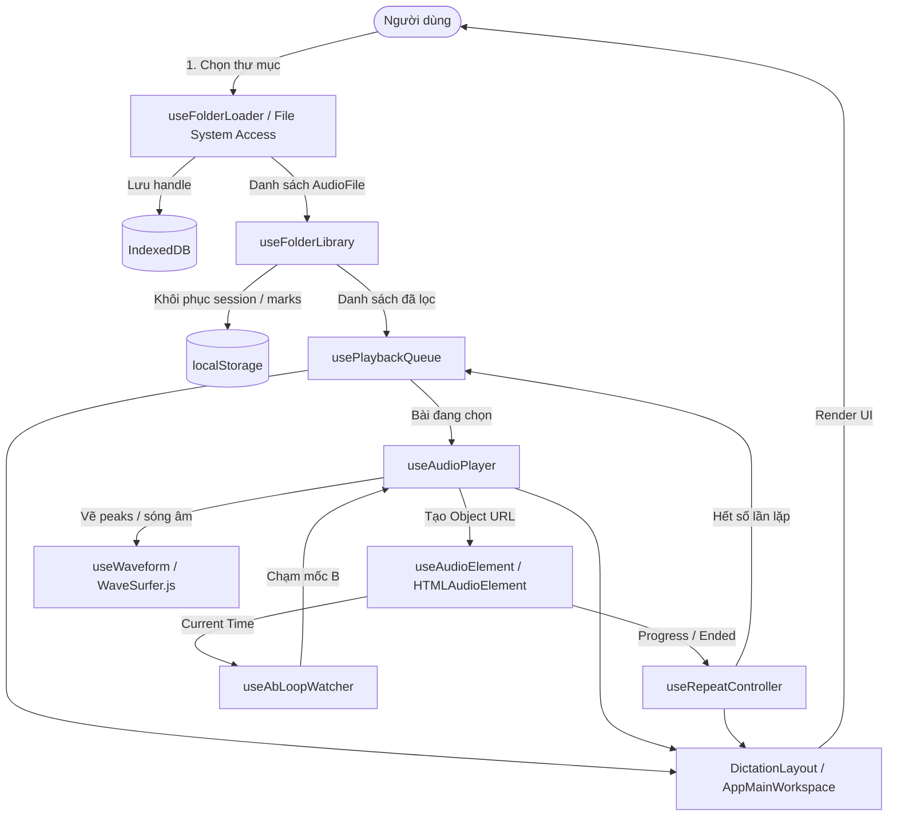

# Kiến Trúc Ứng Dụng (Architecture Guide)

Tài liệu này mô tả kiến trúc phân lớp, nguyên tắc phụ thuộc, luồng dữ liệu và danh mục trách nhiệm của các module trong ứng dụng **Listening Dictation App** sau đợt tái cấu trúc Phase 3.

---

## 1. Sơ Đồ Cây Thư Mục & Phân Lớp Kiến Trúc

```
listening-dictation-app/
├── app/                        # Next.js App Router (Entry point, Shell, Layout)
│   ├── layout.tsx              # Root HTML layout, metadata, viewport, PWA link tags
│   └── page.tsx                # Client entry point với SSR = false
├── components/                 # Presentation & Feature UI Components
│   ├── ui/                     # Primitives dùng chung (Modal, Switch, NumberField, Slider, SegmentedControl)
│   ├── pwa/                    # PWA Components (InstallButton, UpdateToast, OfflineBadge)
│   ├── welcome/                # Welcome Screen modules (Hero, Features, RecentFolders, PreviewPlayer, FloatingChips)
│   ├── dictation-app.tsx       # Root Orchestrator (State composition & event wiring)
│   ├── dictation-layout.tsx    # Layout Shell (Sidebar + Workspace + Dialogs)
│   ├── dictation-welcome-view.tsx # Standalone view khi chưa nạp thư mục
│   ├── app-main-workspace.tsx  # Workspace chính (Header, Waveform, Toolbar, Cards)
│   ├── sidebar.tsx             # Drawer & collapsible file playlist
│   ├── player-card.tsx         # Waveform canvas, scrub bar, time display
│   ├── toolbar-card.tsx        # Dictation controls (Repeat count, Gap, Skip, Speed, A-B, Volume)
│   ├── waveform-region.tsx     # A-B Loop highlight overlay & draggable handles
│   └── ...
├── hooks/                      # Custom Hooks (Application State & Logic)
│   ├── use-audio-player.ts     # Audio engine orchestrator hook (Waveform + MediaElement)
│   ├── use-audio-element.ts    # HTMLAudioElement lifecycle, pitch/rate, and event listeners
│   ├── use-waveform.ts         # WaveSurfer.js lifecycle, peaks drawing, zoom
│   ├── use-ab-loop.ts          # Pure A-B timestamp boundary state
│   ├── use-ab-loop-watcher.ts  # RAF loop watcher checking audio time against B boundary
│   ├── use-playback-queue.ts   # Queue filtering, search, selection, auto-advance flags
│   ├── use-repeat-controller.ts# Repeat count & gap wait orchestration
│   ├── use-dictation-loop.ts   # Countdown timer & wait state primitives
│   ├── use-dictation-actions.ts# User action callbacks (play/replay/A-B/star/reset)
│   ├── use-folder-library.ts   # Filesystem folder persistence, session restoration
│   ├── use-folder-loader.ts    # File picker API & webkitdirectory fallback
│   ├── use-player-settings.ts  # Volume, speed, gap, repeat preferences synced to storage
│   ├── use-keyboard-shortcuts.ts# Global hotkey mapping & input field suppression
│   ├── use-service-worker.ts   # PWA update lifecycle & reload toast
│   ├── use-pwa-install.ts      # beforeinstallprompt hook
│   └── use-online-status.ts    # Navigator online/offline watcher
├── lib/                        # Pure Domain Utilities & Infrastructure
│   ├── audio.ts                # Audio pitch & playbackRate configuration
│   ├── abLoop.ts               # Pure A-B loop calculations (clamp, sanitize, validate)
│   ├── queue.ts                # Queue building, filtering, navigation (next/prev)
│   ├── naturalSort.ts          # Natural filename sorting (e.g. 1, 2, 10)
│   ├── format.ts               # Time and string formatting utilities
│   ├── fs.ts                   # File System Access API & directory traversal
│   ├── idb.ts                  # IndexedDB handle storage
│   ├── storage.ts              # LocalStorage sync, validation, migration
│   ├── keyboard.ts             # Keyboard shortcut key matching
│   ├── i18n.tsx                # Internationalization context & translations
│   └── pwa.ts                  # Service worker registration helpers
```

---

## 2. Quy Tắc Phụ Thuộc (Dependency Rules)

Kiến trúc tuân thủ nguyên tắc **phụ thuộc một chiều (unidirectional dependency)** từ ngoài vào trong:

```
[Layer 5: Orchestration]  DictationApp -> DictationLayout
       ↓
[Layer 4: Features]       AppMainWorkspace, Sidebar, PlayerCard, ToolbarCard, WelcomeScreen
       ↓
[Layer 3: UI Primitives]  Modal, Switch, NumberField, Slider, SegmentedControl
       ↓
[Layer 2: Hooks/State]    useAudioPlayer, usePlaybackQueue, useRepeatController, useFolderLibrary
       ↓
[Layer 1: Pure Lib]       lib/queue, lib/abLoop, lib/naturalSort, lib/fs, lib/storage
```

- **Quy tắc 1 (Layer 1 thuần túy):** Các module trong `lib/` (trừ `i18n.tsx`) hoàn toàn KHÔNG import React hay bất kỳ UI component nào. Mọi logic tính toán (A-B loop, sắp xếp tự nhiên, queue navigation, storage migration) là deterministic và có thể test độc lập với 100% độ tin cậy.
- **Quy tắc 2 (Không import vòng - No circular imports):** Không có quan hệ vòng giữa các hook hoặc giữa các component.
- **Quy tắc 3 (Giới hạn kích thước file):** Tuyệt đối không file nào vượt quá 250 dòng. Mọi component phức tạp đều được phân rã thành sub-components hoặc sub-hooks chuyên biệt.

---

## 3. Luồng Dữ Liệu (Data Flow)



1. **Khởi tạo & Nạp thư mục:**
   - Người dùng click chọn thư mục qua `useFolderLoader`. API `showDirectoryPicker` quét file đệ quy (hoặc fallback `<input webkitdirectory>` trên Safari).
   - Directory handle được lưu vào IndexedDB để ghi nhớ quyền truy cập.
   - Danh sách file được nạp vào `useFolderLibrary`, áp dụng dấu sao/đã nghe từ `localStorage`.
2. **Quản lý Hàng đợi & Phát:**
   - `usePlaybackQueue` xây dựng hàng đợi dựa trên bộ lọc (Tất cả, Gắn sao, Chưa nghe) và từ khóa tìm kiếm.
   - Khi chọn một file, `useAudioPlayer` nạp file vào `HTMLAudioElement` và render sóng âm qua `WaveSurfer.js`.
3. **Vòng lặp Luyện nghe & A-B Repeat:**
   - Trong quá trình phát, `useRepeatController` theo dõi tiến độ (đánh dấu nghe xong ở 85%). Khi hết bài, controller đếm số lần lặp, đếm ngược thời gian nghỉ (`gapSeconds`), và tự động chuyển sang câu kế tiếp (`autoNext`).
   - Nếu A-B loop được kích hoạt, `useAbLoopWatcher` giám sát qua `requestAnimationFrame`. Khi chạm mốc `B`, âm thanh tự động tua về `A` và lặp lại theo cấu hình.

---

## 4. Danh Mục Trách Nhiệm Chi Tiết (Module Catalog)

### 4.1 Hooks
- `useAudioPlayer`: Tổng hợp điều khiển âm thanh, đồng bộ giữa element âm thanh và canvas sóng âm WaveSurfer.
- `useAudioElement`: Quản lý thẻ `<audio>` ngầm, bảo toàn cao độ khi đổi tốc độ (`preservesPitch`), giải phóng Object URL để tránh rò rỉ bộ nhớ.
- `useWaveform`: Khởi tạo và đồng bộ WaveSurfer.js, xử lý resize observer, click to seek, zoom.
- `useAbLoop`: Quản lý giá trị mốc `A` và `B`, tính toán khoảng hợp lệ tối thiểu (`MIN_AB_GAP_SEC`).
- `useAbLoopWatcher`: Đồng bộ thời gian thực mốc phát hiện khi chạm giới hạn B để nhảy về A.
- `usePlaybackQueue`: Tính toán danh sách phát sau lọc/tìm kiếm, xử lý chọn bài, tiến/lùi, cờ autoplay.
- `useRepeatController`: Điều phối số lần lặp lại câu (`repeatCount`), thời gian chờ giữa các lần lặp (`gapSeconds`), và tự chuyển bài (`autoNext`).
- `useDictationLoop`: Quản lý bộ đếm ngược thời gian nghỉ (`gapCountdown`) bằng interval chính xác.
- `useDictationActions`: Đóng gói các hàm xử lý tương tác người dùng (phát, replay, tua, đặt A/B, đánh dấu sao, reset) giúp component gọn gàng.
- `useFolderLibrary`: Đồng bộ trạng thái thư mục, danh sách file, bộ lọc và đánh dấu.
- `useFolderLoader`: Tương tác với File System Access API và input tệp Safari.
- `usePlayerSettings`: Lưu trữ và khôi phục các cài đặt nghe vào `localStorage`.
- `useKeyboardShortcuts`: Lắng nghe phím tắt toàn cục, tự động ức chế khi đang nhập văn bản.
- `useServiceWorker`: Quản lý vòng đời Service Worker và thông báo cập nhật bản mới.

### 4.2 Libraries (`lib/`)
- `lib/audio.ts`: Cấu hình cao độ và tốc độ phát chuẩn cho Web Audio/MediaElement.
- `lib/abLoop.ts`: Logic thuần xử lý mốc A-B, clamp phạm vi, chuẩn hóa khoảng cách.
- `lib/queue.ts`: Thuật toán lọc danh sách, tìm kiếm, tìm bài kế tiếp/trước đó.
- `lib/naturalSort.ts`: Sắp xếp chuỗi tự nhiên (hỗ trợ số học, tiền tố số 0, Unicode tiếng Việt).
- `lib/format.ts`: Định dạng giây thành `mm:ss` / `hh:mm:ss`, định dạng tên file.
- `lib/fs.ts`: Quét file âm thanh hợp lệ (mp3, m4a, wav, flac, ogg, aac), bỏ qua file ẩn.
- `lib/idb.ts`: Giao tiếp IndexedDB lưu trữ directory handle an toàn.
- `lib/storage.ts`: Đọc/ghi `localStorage`, migration dữ liệu từ phiên bản cũ, fallback an toàn khi lỗi.
- `lib/keyboard.ts`: Khớp phím tắt, ngăn chặn kích hoạt ngoài ý muốn.
- `lib/i18n.tsx`: Context đa ngôn ngữ Việt / Anh nhẹ, không cần thư viện ngoài.
- `lib/pwa.ts`: Đăng ký Service Worker và nhận diện môi trường cài đặt.
