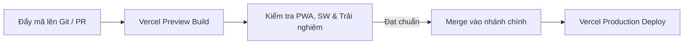

# Hướng Dẫn Triển Khai Vercel (Deployment Guide)

Tài liệu này hướng dẫn chi tiết quy trình triển khai **Listening Dictation App** lên nền tảng **Vercel** dưới dạng Static Export (PWA), cấu hình bảo mật, chiến lược bộ nhớ đệm (caching) và quy trình xử lý sự cố.

---

## 1. Cấu Hình Dự Án Trên Vercel

Ứng dụng được cấu hình xuất bản tĩnh hoàn toàn (`output: 'export'`) trong `next.config.ts`, tạo ra thư mục phân phối tĩnh `out/`.

| Thiết lập trên Vercel | Giá trị cấu hình |
|---|---|
| **Framework Preset** | `Next.js` |
| **Build Command** | `npm run build` (hoặc để mặc định) |
| **Output Directory** | **Để mặc định (KHÔNG ghi đè)** — Next.js tự động nhận diện `output: 'export'` |
| **Install Command** | `npm install` |
| **Node.js Version** | `20.x` hoặc `22.x` |
| **Environment Variables** | **Không có biến môi trường nào** (Ứng dụng chạy client-side 100%, bảo mật tuyệt đối) |

---

## 2. Chiến Lược Header & Cache (`vercel.json`)

Tệp `vercel.json` ở thư mục gốc đã được thiết lập sẵn các quy tắc cache và bảo mật theo chuẩn Web PWA:

### 2.1 Bộ Nhớ Đệm (Caching Strategy)
- **Tệp Service Worker (`/sw.js`):**
  - `Cache-Control: public, max-age=0, must-revalidate`
  - `Service-Worker-Allowed: /`
  - *Mục đích:* Trình duyệt luôn luôn kiểm tra phiên bản mới của Service Worker mỗi khi truy cập, ngăn ngừa tình trạng kẹt phiên bản cũ.
- **Tài nguyên tĩnh có băm (`/_next/static/*`):**
  - `Cache-Control: public, max-age=31536000, immutable`
  - *Mục đích:* Tối ưu tốc độ tải trang, tận dụng CDN cache 1 năm vì tên file có hash thay đổi theo từng bản build.
- **Biểu tượng ứng dụng (`/icons/*`):**
  - `Cache-Control: public, max-age=31536000, immutable`
- **Web App Manifest (`/manifest.webmanifest`):**
  - `Content-Type: application/manifest+json`
  - `Cache-Control: public, max-age=0, must-revalidate`

### 2.2 Header Bảo Mật (Security Headers)
- `X-Content-Type-Options: nosniff` (Chống MIME type sniffing)
- `X-Frame-Options: DENY` (Chống clickjacking)
- `Referrer-Policy: strict-origin-when-cross-origin`
- `Permissions-Policy: camera=(), microphone=(), geolocation=(), browsing-topics=()`
- `Content-Security-Policy`:
  `default-src 'self'; script-src 'self' 'unsafe-inline'; style-src 'self' 'unsafe-inline'; img-src 'self' data: blob:; media-src 'self' blob:; connect-src 'self'; worker-src 'self' blob:; object-src 'none'; base-uri 'self';`
  *(Đã cấu hình rõ ràng `media-src 'self' blob:` để phát âm thanh mượt mà từ file cục bộ)*.

---

## 3. Quy Trình Triển Khai (Deployment Workflow)

1. **Bước 1 — Triển khai Preview (Preview Deployment):**
   - Tạo Pull Request hoặc đẩy mã lên nhánh thử nghiệm. Vercel tự động tạo URL xem trước (Preview URL).
   - Truy cập URL xem trước để kiểm tra:
     - Tải ứng dụng lần đầu.
     - Kiểm tra Service Worker đã đăng ký thành công trong DevTools -> Application -> Service Workers.
     - Thử ngắt mạng (offline) xem app shell có mở được không.
     - Kiểm tra trên Safari (macOS / iOS) và Chrome.
2. **Bước 2 — Triển khai Production (Production Deployment):**
   - Hợp nhất (Merge) PR vào nhánh `main`.
   - Vercel tự động chạy `npm run build` và phát hành lên Production domain.

---

## 4. Cơ Chế Cập Nhật Service Worker & Xử Lý Sự Cố

### 4.1 Quy Trình Cập Nhật Bản Mới (Update Flow)
1. Khi có bản build mới được deploy, trình duyệt tải `sw.js` mới ở chế độ nền.
2. Service Worker mới được cài đặt nhưng ở trạng thái `waiting` (chưa tự kích hoạt để tránh làm gián đoạn bài nghe đang phát).
3. Ứng dụng phát hiện có bản mới và hiển thị thông báo **UpdateToast** ở góc dưới màn hình ("Có bản cập nhật mới — Tải lại").
4. Người dùng bấm nút **Tải lại**: Ứng dụng gửi thông điệp `{ type: 'SKIP_WAITING' }` đến Service Worker và gọi `window.location.reload()`.

### 4.2 Xử Lý Sự Cố Kẹt Cache (Troubleshooting)
- **Nếu người dùng báo cáo giao diện không cập nhật:**
  - Hướng dẫn người dùng bấm vào nút "Tải lại" trên thông báo cập nhật.
  - Hoặc thực hiện hard-reload: `Cmd + Shift + R` (macOS) hoặc `Ctrl + F5` (Windows).
- **Quy trình Khôi Phục Nhanh (Rollback):**
  - Trên Vercel Dashboard -> Chọn tab **Deployments**.
  - Tìm bản triển khai ổn định gần nhất -> Bấm vào menu 3 chấm -> Chọn **Promote to Production**.
  - Vercel sẽ chuyển hướng lưu lượng truy cập sang bản cũ ngay lập tức (dưới 10 giây) mà không cần build lại.
