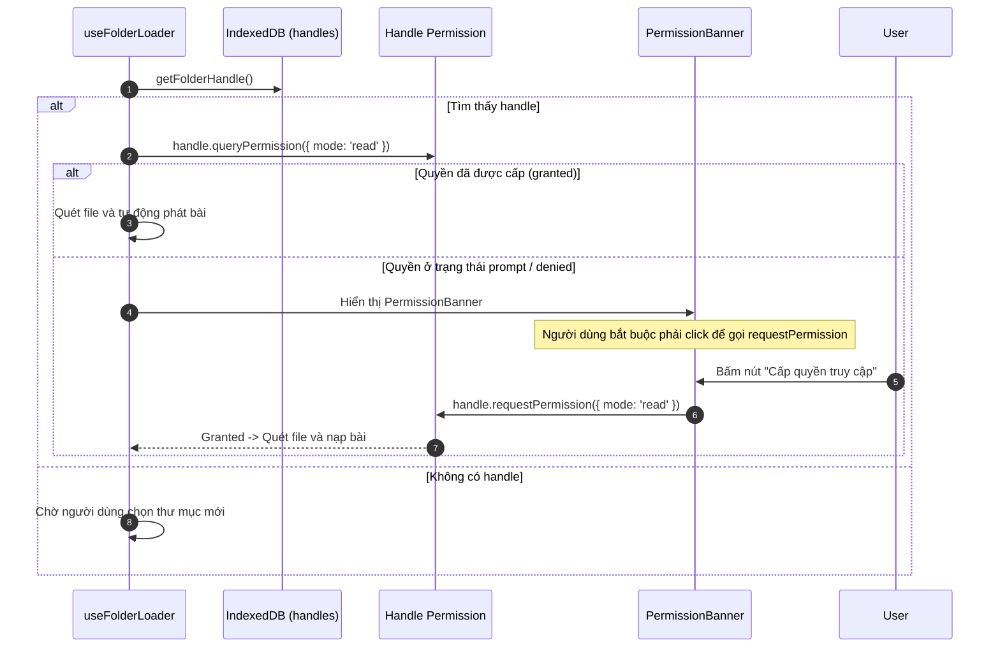

# KIẾN TRÚC LƯU TRỮ & DỮ LIỆU CỤC BỘ (STORAGE & DATA ARCHITECTURE)

> **Dự án:** Nghe chép — Audio Dictation Player (`listening-dictation-app`)  
> **Nguyên tắc:** 100% Client-Side, Không Server, Không Database ngoài, Bảo Mật Dữ Liệu Riêng Tư  
> **Nguồn sự thật:** `lib/storage.ts`, `lib/idb.ts`, `lib/fs.ts`, `hooks/use-folder-loader.ts`

---

## 1. Tổng Quan Kiến Trúc Lưu Trữ

Ứng dụng kết hợp 3 cơ chế lưu trữ trình duyệt chuyên biệt để đảm bảo trải nghiệm liền mạch:

```
┌────────────────────────────────────────────────────────────────────────┐
│                          BỘ NHỚ TRÌNH DUYỆT                             │
├─────────────────────┬──────────────────────────┬───────────────────────┤
│    IndexedDB        │       LocalStorage       │ File System Access /  │
│  (dictation_db)     │      (dictation_*)       │ Memory Object URL     │
├─────────────────────┼──────────────────────────┼───────────────────────┤
│ Lưu trữ             │ Lưu trữ cấu hình nghe,   │ Quét tệp từ đĩa cứng, │
│ FileSystemDirectory │ lịch sử câu đang nghe,   │ tạo blob: URL phát    │
│ Handle (Chrome/Edge)│ dấu sao & thư mục gần đây│ âm thanh trực tiếp    │
└─────────────────────┴──────────────────────────┴───────────────────────┘
```

---

## 2. IndexedDB — Quản Lý Directory Handle (`lib/idb.ts`)

### 2.1. Cấu Trúc Cơ Sở Dữ Liệu
- **Tên Database (`DB_NAME`):** `dictation_db` (Version 1).
- **Object Store (`STORE_NAME`):** `handles`.
- **Khóa cố định (`HANDLE_KEY`):** `"folderHandle"`.

### 2.2. Kiểu Dữ Liệu Kết Quả (Result Pattern)
Mọi hàm trong `lib/idb.ts` trả về kiểu dữ liệu phân biệt lỗi rõ ràng:
```typescript
export type IdbResult<T> =
  | { ok: true; value: T }
  | { ok: false; reason: string };
```

### 2.3. Các Thao Tác Cơ Sở
1. `saveFolderHandle(handle: FileSystemDirectoryHandle): Promise<IdbResult<void>>`: Lưu handle vào store.
2. `getFolderHandle(): Promise<IdbResult<FileSystemDirectoryHandle | null>>`: Đọc handle đã lưu.
3. `clearFolderHandle(): Promise<IdbResult<void>>`: Xóa handle khi reset ứng dụng.

### 2.4. Vòng Đời Xin Quyền & Khôi Phục (Permission Lifecycle)


---

## 3. LocalStorage — Cài Đặt, Phiên Học & Đánh Dấu (`lib/storage.ts`)

LocalStorage lưu trữ 4 nhóm khóa dữ liệu độc lập có tiền tố `dictation_`:

```typescript
export const STORAGE_KEYS = {
  SETTINGS: "dictation_settings",
  SESSION: "dictation_session",
  MARKS: "dictation_marks",
  RECENT_FOLDERS: "dictation_recent_folders",
} as const;
```

### 3.1. Cài Đặt Người Dùng (`dictation_settings`)
- **Schema:**
  ```typescript
  export type Settings = {
    language: "vi" | "en";                      // Mặc định: 'vi'
    playbackRate: 0.5 | 0.75 | 1 | 1.25 | 1.5; // Mặc định: 1
    volume: number;                             // Mặc định: 0.8 (0..1)
    skipSeconds: number;                        // Mặc định: 5 (1..30)
    autoNext: boolean;                          // Mặc định: true
    repeatCount: number;                        // Mặc định: 1 (1..99)
    gapSeconds: number;                         // Mặc định: 2 (0..30)
    sidebarCollapsed: boolean;                  // Mặc định: false
  };
  ```
- **Hàm truy xuất:**
  - `getStoredSettings(): Settings`: Đọc và merge với `DEFAULT_SETTINGS` (an toàn chống thiếu trường).
  - `saveStoredSettings(updates: Partial<Settings>): void`: Cập nhật một phần cấu hình.

---

### 3.2. Phiên Học Hiện Tại (`dictation_session`)
- **Schema:**
  ```typescript
  export type Session = {
    folderName: string;
    lastFile: string; // Tên file cuối cùng (KHÔNG lưu vị trí giây)
  };
  ```
- **Mục đích:** Ghi nhớ chính xác bài đang nghe dở trong thư mục. Khi người dùng mở lại thư mục, hệ thống tự động cuộn danh sách và chọn lại đúng bài này.
- **Hàm truy xuất:** `getStoredSession()`, `saveStoredSession()`, `clearStoredSession()`.

---

### 3.3. Dấu Sao & Trạng Thái Đã Nghe (`dictation_marks`)
- **Schema:**
  ```typescript
  export type Marks = {
    [folderName: string]: {
      [fileName: string]: {
        listened?: boolean; // Tự động đánh dấu khi nghe >= 85% thời lượng
        star?: boolean;     // Người dùng bấm phím S hoặc click icon sao
      };
    };
  };
  ```
- **Phân vùng theo thư mục:** Mỗi thư mục có bảng đánh dấu riêng biệt theo `folderName`. Đổi tên bài hoặc đổi thư mục không làm ô nhiễm dữ liệu của thư mục khác.
- **Hàm truy xuất:** `getStoredMarks()`, `saveMark(folderName, fileName, update)`.

---

### 3.4. Danh Sách Thư Mục Gần Đây (`dictation_recent_folders`)
- **Schema:**
  ```typescript
  export type RecentFolder = {
    folderName: string;
    lastFile: string;
    totalFiles: number;
    lastIndex: number;
    updatedAt: number; // Timestamp (Date.now())
  };
  ```
- **Quy tắc:**
  - Giới hạn tối đa **3 thư mục gần nhất** (`MAX_RECENT_FOLDERS = 3`).
  - Thư mục được mở mới nhất luôn nằm ở đầu danh sách.
  - Sử dụng cơ chế phát sự kiện tùy biến (`Event("dictation_recent_folders_changed")`) và sự kiện `storage` chuẩn để đồng bộ dữ liệu thời gian thực giữa các tab hoặc components thông qua `subscribeRecentFolders`.

---

## 4. Quét Tệp Hệ Thống & Bộ Lọc Đuôi File (`lib/fs.ts`)

### 4.1. Định Dạng m Thanh Hợp Lệ
Ứng dụng chỉ nạp các file có phần mở rộng âm thanh được hỗ trợ:
```typescript
export const AUDIO_EXTENSIONS = [
  ".mp3",
  ".m4a",
  ".wav",
  ".aac",
  ".flac",
  ".ogg",
] as const;
```

### 4.2. Bỏ Qua Tệp Ẩn & File Hệ Thống
- Khi duyệt đệ quy thư mục qua `FileSystemDirectoryHandle`:
  - Mọi file hoặc thư mục con có tên bắt đầu bằng dấu chấm (`.`, ví dụ `.DS_Store`, `._file.mp3`) đều bị **bỏ qua hoàn toàn**.
  - Không quét sâu quá mức gây tràn ngăn xếp; phân loại file theo đuôi và gắn số thứ tự `index` ban đầu.

### 4.3. Sắp Xếp Tự Nhiên (Natural Sort)
Các file audio của bài thi (ETS TOEIC) thường có định dạng `Test01_Q01.mp3`, `Test01_Q10.mp3`, `Test01_Q100.mp3`.
- Thay vì dùng sort chuỗi thông thường (`1, 10, 100, 2`), `lib/naturalSort.ts` phân tích các cụm số nguyên để sắp xếp chuẩn xác: `1, 2, ..., 9, 10, 11, ..., 99, 100`.
- Hỗ trợ đầy đủ tiếng Việt có dấu qua `localeCompare(..., 'vi', { numeric: true, sensitivity: 'base' })`.

---

## 5. Xóa Sạch Dữ Liệu (Reset Application Data)

Khi người dùng xác nhận trong `ResetDialog`, hàm `clearAllStorage()` được kích hoạt:
1. Xóa `dictation_settings`.
2. Xóa `dictation_session`.
3. Xóa `dictation_marks`.
4. Xóa `dictation_recent_folders`.
5. Gọi `clearFolderHandle()` xóa IndexedDB handle.
6. Xóa cache in-memory và thông báo sự kiện cập nhật.
7. **Bảo đảm an toàn:** Không có bất kỳ tác động nào tới dữ liệu thực tế trên ổ đĩa người dùng.

